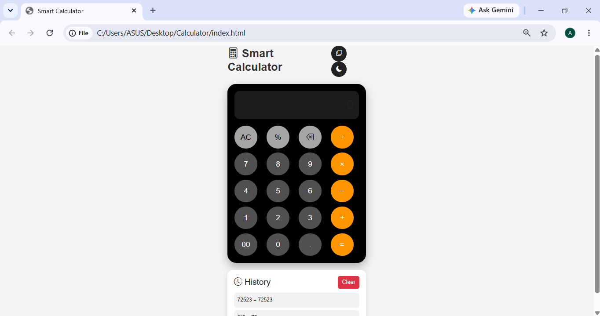

<div align="center">


<a href="https://apurva-chaudhari.github.io/Smart-Calculator/">
  
</a>

<br/><br/>


</div>

<br/>

A modern, responsive calculator with a clean interface, **dark/light mode**, **keyboard shortcuts**, and **persistent calculation history** — built with vanilla JavaScript and Bootstrap.

<br/>

<div align="center">

```
┌─────────────────────────────┐
│  12 + 8 × 3                 │
│                       = 36  │
└─────────────────────────────┘
```

</div>

<br/>

## 📸 Preview

<div align="center">

</div>

<br/>

## ⚡ Feature Panel

<div align="center">

| 🔢 Core Ops | 🎨 Experience | 🧠 Smart Extras |
|:---:|:---:|:---:|
| Addition | Dark / Light Mode | Calculation History |
| Subtraction | Responsive Design | History via Local Storage |
| Multiplication | Keyboard Support | Copy Result |
| Division | Error Handling | Backspace / Clear (AC) |
| Percentage (%) | — | — |

</div>

<br/>

## ⌨️ Keyboard Shortcuts

<div align="center">

| Key | Action |
|:---:|---|
| `0`–`9` | Enter numbers |
| `+` `-` `*` `/` | Operators |
| `.` | Decimal point |
| `Enter` | Calculate result |
| `Backspace` | Delete last character |
| `Esc` | Clear display |
| `%` | Percentage |

</div>

<br/>

## 🛠 Built With

<div align="center">


<br/>
<sub>HTML5 · CSS3 · JavaScript (ES6) · Bootstrap 5 · Bootstrap Icons</sub>

</div>

<br/>

## 📂 Project Structure

<details>
<summary>Click to expand</summary>

```
Smart-Calculator/
│
├── index.html
│
├── css/
│   └── style.css
│
├── js/
│   └── script.js
│
├── images/
│   └── calculator-preview.png
│
└── README.md
```

</details>

<br/>

## 🚀 Run It Locally

**1. Clone the repository**
```bash
git clone https://github.com/apurva-chaudhari/Smart-Calculator.git
```

**2. Open the project folder**

**3. Launch it** — either:
- Double-click `index.html`, or
- Open with **VS Code Live Server**

<br/>

## 🎯 What's Next

- [ ] Scientific Calculator mode
- [ ] Memory Buttons (M+, M-, MR, MC)
- [ ] Export Calculation History
- [ ] Voice Input
- [ ] Multiple Color Themes

<br/>

## 👨‍💻 Author

<div align="center">

**Apurva Chaudhari**
*Bachelor of Engineering (B.E.) Student*

<a href="https://github.com/apurva-chaudhari"></a>

</div>

<br/>

<div align="center">

📄 *Developed for educational and learning purposes.*

### ⭐ If you like this project, consider giving it a Star on GitHub!


</div>
